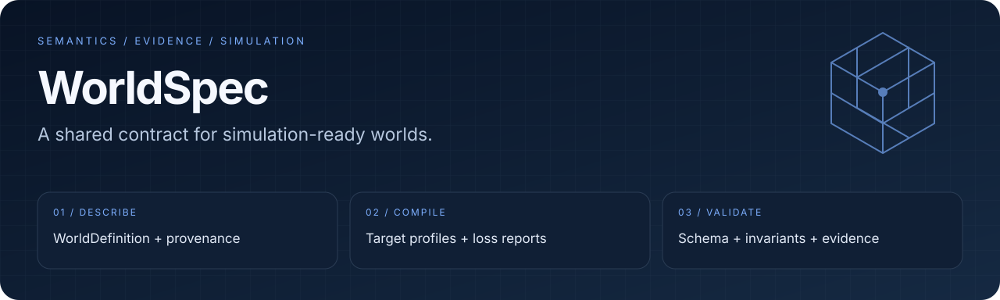

<div align="center">
  
  <h1>WorldSpec</h1>
  <p><strong>为具身资产建立可追溯、可验证、可编译的共同契约。</strong></p>
  <p><a href="https://github.com/eust-w/WorldSpec/actions/workflows/ci.yml"></a>
  
  
  </p>
  <p>
    <a href="#overview">项目亮点</a> ·
    <a href="#quick-start">快速开始</a> ·
    <a href="#workflow">工作流</a> ·
    <a href="#validation">验证与边界</a> ·
    <a href="#documentation">文档</a>
  </p>
  <p><a href="README.en.md">English</a> · <a href="README.md">简体中文</a></p>
</div>

---

<a id="overview"></a>
## 从“有一个模型”到“知道它能做什么”

**WorldSpec** 是面向具身资产的语义与证据模型，以及跨仿真器的编译中间层。它将来源、世界定义、目标运行条件和转换损失放进同一套可检查的契约，帮助团队理解一个资产如何变成仿真输入，以及哪些性质已有证据支持。

| 描述世界 | 编译目标 | 检查证据 |
| :--- | :--- | :--- |
| Schema、来源、语义与对象关系 | TargetProfile、ArtifactBundle、LossReport | 结构校验、跨对象不变量、摘要与一致性报告 |

> [!IMPORTANT]
> 当前为 v0.1 开发基线。规范与校验工具已经有实现，但整体验收尚未完成；不能将某个本地 Profile 的结果扩展为所有平台或完整机器人任务已经通过。

<a id="quick-start"></a>
## 快速开始：验证最小世界

需要 **Rust 1.89+**。以下流程不需要 GPU 或训练权重。

```bash
git clone https://github.com/eust-w/WorldSpec.git
cd WorldSpec
cargo run --quiet -p worldspec-cli -- \
  validate examples/minimal-cube/world.json --output json
```

文档与 Schema 基线检查使用 Python；CI 使用 Python 3.12：

```bash
python3 -m venv .venv
source .venv/bin/activate
python -m pip install -r requirements-dev.txt
python scripts/validate_baseline.py
```

从 [最小示例](examples/minimal-cube/) 开始，再看 [Schema](schemas/0.1/) 和 [Validator 边界](docs/zh-CN/implementation/validator.md)。校验失败应被定位和解释，不应通过更改声明等级来绕过。

<a id="workflow"></a>
## 一个世界，两条相互关联的链

```text
SourceBundle → AssetDraft → WorldDefinition
                                  │
                    TargetProfile + BuildIntent
                                  ▼
                 ArtifactBundle + LossReport + BuildManifest
                                  │
                                  ▼
                     ConformanceReport + Certificate
```

| 核心对象 | 回答的问题 |
| :--- | :--- |
| `SourceBundle` | 输入来自哪里，关联哪些来源与权利信息？ |
| `WorldDefinition` | 世界里有哪些对象、属性和关系？ |
| `TargetProfile` / `BuildIntent` | 面向什么运行环境，以什么目标编译？ |
| `ArtifactBundle` / `LossReport` | 输出是什么，转换中保留或损失了什么？ |
| `ConformanceReport` / `Certificate` | 哪些检查在什么条件下成立？ |

### 实现分层

| 层 | 当前入口 |
| :--- | :--- |
| 规范与示例 | [JSON Schema](schemas/0.1/)、[正负示例](examples/) |
| 校验与摘要 | [Rust Core](crates/worldspec-core/)、[CLI](crates/worldspec-cli/) |
| 编译与证明 | [Compiler](crates/worldspec-compiler/)、[Certificate](crates/worldspec-cert/) |
| 产物与执行 | [CAS](crates/worldspec-cas/)、[Forge](crates/worldspec-forge/) |
| 服务与预览 | [Loopback API](crates/worldspec-server/)、[Three.js 预览](web/threejs-preview/) |

<a id="validation"></a>
## 验证有层次，结论有范围

```bash
cargo test --workspace
python scripts/validate_baseline.py
python scripts/validate_compilers.py
python scripts/validate_robot_ingestion.py
```

运行时验证需要对应依赖，不属于最小无 GPU 快速开始：

```bash
python scripts/validate_l2_certification.py
python scripts/validate_l2_threejs.py
```

| 验证对象 | 当前边界 |
| :--- | :--- |
| Schema / Validator | Draft 2020-12 与已登记的跨对象不变量 |
| MuJoCo / Three.js | 参考编译与本地运行证据；结果绑定实际 OS、架构和 Profile |
| L2 Certificate | 本地脚本可生成 unsigned 证书并检查篡改拒绝；不代表第三方认证 |
| OpenUSD / Isaac Sim | 输入或原生载荷保留不等于已获运行认证 |
| H1 任务策略 | 研究记录仍标记 `non_publishable`；不能宣传完整厨房任务已通过 |
| HTTP 服务 | 默认 `127.0.0.1:8090`；尚无多租户、账号或远程服务安全边界 |

<details>
<summary><strong>展开：保留的详细研究检查点</strong></summary>

> 当前仓库状态：包含 v0.1 双语文档、105 个 JSON Schema、正负示例、Rust
> Core/Validator、Canonical Digest、文件 CAS、SQLite WAL 作业索引、CLI 与
> loopback 异步 API。MuJoCo/Three.js 参考编译、Digest 绑定的 L2
> Conformance/Certificate、L3 TaskRun/RuntimeRecord 证据核验、Reference
> Predicate Engine、真实 MuJoCo 3.6.0 加载与步进、真实
> Chromium/Three.js 0.185.1 加载与截图及产物篡改拒绝已有本地执行证据；
> macOS arm64 本地 Profile 达到 L2，但尚无 Linux x86_64 参考 Profile 的
> L2 证书。H1 + 右手 Robotiq 的 A800 训练链已经完成站立、过渡、Capture、
> 任务载荷和正式 100M 阶段；100M Checkpoint 因零命令站立回归失败保持
> `non_publishable`。冻结 Supervisor 的十项门通过后，单次完整厨房暴露了
> 步行后操作平衡问题；mixed-reset-v3 达到静态 `5/5`，但修正后的
> post-walk-biased-v4 纯分布评测只有步行后 `3/5`；
> on-policy-continuation-v5 继续得到步行后 `3/5`、静态 `5/5`，但其归档
> 保留七个尚未逐项正式评估的 Checkpoint。当前只放行
> checkpoint-portfolio-v6 与 memory-isolated-v7 均保存七个候选，但逐候选
> 评估仍在正式门前因同进程设备内存生命周期 OOM；锁定 v10 已验证独立
> 派生模型目录和全新评估进程，但第一个候选在切换至 `from_rest` 套件时仍因
> 评估进程内设备状态累积 OOM。suite-isolated-v11 已在真实 A800 上完成
> 七候选训练与 14/14 隔离评测，关闭了运行链路问题；但最佳候选的步行后
> 套件仅 4/5，正式操作平衡门失败，策略保持 `non_publishable`。
> v13 在真实 A800 上完成七候选和 14/14 隔离评测，但所有候选都在同一个
> 步行后状态失败，最终仍为步行后 `4/5`、静态 `5/5`。v14 随后使用 50%
> 静态、25% 固定困难状态索引 565、25% 均匀冻结状态库完成真实 A800 训练
> 和全部 14/14 隔离评测；七个候选仍全部为步行后 `4/5`、静态 `5/5`。
> 固定困难测试的六项指标虽改善，但正式操作平衡门未改变，策略仍为
> `non_publishable`。ADR-0048 已选择路线 A：先在冻结状态 565、冻结 v14
> 策略和不变质量门下搜索构造性恢复 Witness。该诊断目前只有实现和本地测试，
> 尚未形成真实 A800 结果；搜索未命中只能记为 `unknown`。当前不允许自动
> 重试、启动完整厨房单次、厨房 5/5、100M 或声明
> L3。真实
> A800/H100 图像/视频生成、完整 CAD/USD 原生运行、授权明确的真实厨房联合
> 证据和 H1 厨房 5/5 均未完成，所以产品 v0.1 尚未整体验收。

</details>

<a id="documentation"></a>
## 文档导航

| 入口 | 内容 |
| :--- | :--- |
| [中文文档](docs/zh-CN/index.md) · [English docs](docs/en/index.md) | 双语导航；中文为规范真源 |
| [产品需求](docs/zh-CN/product/prd-v0.1.md) | v0.1 范围 |
| [架构总览](docs/zh-CN/architecture/overview.md) | 对象模型与系统边界 |
| [决策登记](docs/zh-CN/decision-register.md) | 已接受的设计与实验决策 |
| [OpenAPI](openapi/worldspec-v1.yaml) | API 契约 |
| [许可治理](docs/zh-CN/governance/licensing.md) | 开放核心与贡献政策 |

## 许可状态

已接受的方向是 **AGPL-3.0 开放核心 + 商业许可 + CLA**。但 [LICENSES/README.md](LICENSES/README.md) 明确指出最终许可与 CLA 文本尚未纳入基线。仓库公开可见不等于这些文件已经生效；代码、模型、数据和派生产物的许可仍需分别落实。
